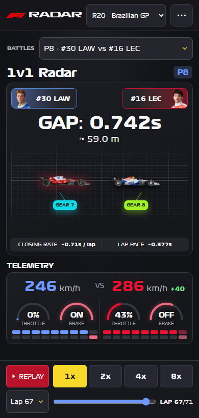
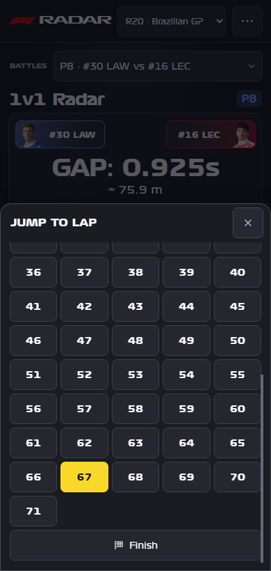
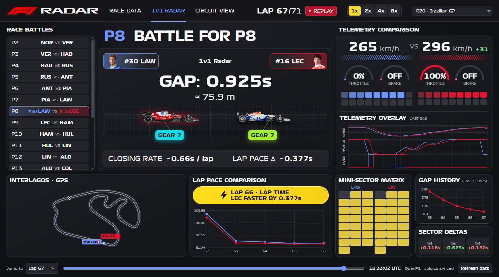

# F1 Race Radar


**A mobile-first Formula 1 race radar for live timing and 2026 replays.** Follow the gap between two drivers from lights out to the finish and explore car telemetry in archived races.

[Open F1 Race Radar](https://fauzansatriar.github.io/f1-race-radar/#radar) · [Latest update](#latest-update) · [Screenshots](#screenshots) · [Live data](#live-data) · [Project structure](#project-structure) · [Credits](#credits-and-disclaimer)

## Latest update

**19 November 2026 · Cockpit camera and race positions**

- Either driver in the desktop duel can be followed with a low chase camera. The view shows illustrative starting grid markings and team badges with race positions above the scene.

**19 November 2026 · Circuit zoom with shared GPS scale**

- Zoom works in Overview and Follow. Track and cars share the same metre scale, and zoom leaves their GPS positions unchanged.

**19 November 2026 · Circuit scale and team badges**

- Circuit car models use an approximate 5.3 m length on the GPS scale. Follow mode zooms in and driver labels show official team logos.

**19 November 2026 · Circuit follow camera and car models**

- The desktop circuit shows team-colored car models oriented by GPS movement. Overview and Follow controls switch between the whole route and a closer view of either driver in the selected duel.

- Circuit View projects the GPS-derived route into perspective and tracks the selected duel on the replay clock. Car markers appear when location samples are available.

**19 November 2026 · Grand Prix picker**

- The Grand Prix selector uses the same branded, keyboard-accessible list as the battle and lap pickers.

**18 November 2026 · Smooth brake display and mobile telemetry**

- The brake gauge and trace interpolate between timestamped on/off samples. The gauge label shows the recorded pedal state.
- The mobile telemetry comparison includes the throttle and brake history bars for both drivers.
- The isometric cover and screenshot gallery show the updated desktop and mobile radar.
- The red FR mark appears in the browser tab and on the home screen when the PWA is installed. The browser tab and installed app use the name F1 Race Radar.
- The radar uses a plain Lap Pace label, and the footer shows timing and connection messages without a provider credit or sync confirmation.
- The PWA is deployed over HTTPS on GitHub Pages and opens directly to 1v1 Radar when installed.
- The app connects directly to the public F1 timing feed without an account or API key. During an active race, it shows the running order, gaps, lap count, and timing delay. It reconnects automatically after a dropped connection.
- The GP picker lists upcoming races and completed 2026 replays. Replay still includes archived car telemetry, GPS, lap selection, and 1×–8× playback.

## MVP features

- **1v1 Radar** — Pick a battle between adjacent drivers and follow the time gap and estimated distance with driver portraits and team liveries.
- **Live viewing** — See upcoming GPs in the selector. The default view follows an active race when fresh timing arrives. Selecting a different GP keeps that choice.
- **Race replay** — Browse completed 2026 Grands Prix, starting with the latest available race. Jump to any lap or the finish, scrub the timeline, and switch between **1×, 2×, 4×, and 8×**.
- **Synced telemetry** — Compare speed, throttle, braking, and gear. The radar interpolates car movement and readouts between recorded samples as playback speed changes.
- **Race analysis** — See GPS positions on the circuit, race classification, lap pace, gap history, and sector deltas.
- **Installable PWA** — Add the app to your home screen from a supported browser over HTTPS. It opens straight to 1v1 Radar and caches the app shell and bundled Brazilian GP snapshot for offline use.

## Screenshots

Liam Lawson and Charles Leclerc battle for P8 at Interlagos on lap 67 of the 2026 Brazilian GP.

<p align="center">
  <a href="docs/media/mobile-radar.png"></a>
  <a href="docs/media/mobile-lap-picker.png"></a>
</p>

<details>
<summary>Desktop dashboard with telemetry and circuit map</summary>



</details>

## Run locally

Requires Python 3.10 or newer. The build uses the Python standard library.

```sh
python build.py
python -m http.server 8000 --bind 127.0.0.1 --directory dist
```

Open [1v1 Radar](http://127.0.0.1:8000/#radar). Run `python build.py --standalone` to also generate a single-file preview.

### Install on a phone

Open the [HTTPS app](https://fauzansatriar.github.io/f1-race-radar/) in Chrome on Android or Safari on iOS and choose **Install app** or **Add to Home Screen** from the browser menu. The app opens directly to 1v1 Radar.

## Live data

The browser subscribes directly to the public Formula 1 timing feed during races. The public feed provides race order, gaps, and lap counts. Car sensors and GPS require a subscribed feed. The public app displays its timing-only status during live viewing. [Public timing reference](https://github.com/darshjoshi/pitwall#live-timing-lite--no-auth-reads-f1s-real-time-signalr-feed-during-a-session)

<details>
<summary>Optional self-hosted OpenF1 relay</summary>

For a subscribed sensor and GPS feed, set `OPENF1_USERNAME` and `OPENF1_PASSWORD` in the server environment. [OpenF1 live-data documentation](https://openf1.org/auth.html)

```sh
python -m pip install -r requirements-live.txt
python build.py
python server.py
```

The server renews the OpenF1 token and relays timing, car telemetry, and GPS over a same-origin event stream. `/api/live/status` reports `openf1: "ready"` after authentication and a successful schedule request. To expose the relay, serve it behind HTTPS and forward `/api/live` without response buffering.

</details>

## Project structure

| Path | Contents |
| --- | --- |
| [`src/`](src/) | Radar UI, replay logic, bundled race data, and app assets |
| [`dist/`](dist/) | Ready-to-serve PWA with its manifest and service worker |
| [`docs/media/`](docs/media/) | Isometric cover and full-resolution screenshots |
| [`build.py`](build.py) | Python script that builds the static app |
| [`server.py`](server.py) | Optional live-data relay and PWA server |
| [`gh-pages`](https://github.com/fauzansatriar/f1-race-radar/tree/gh-pages) | Published GitHub Pages build |

## Data sources

| Source | Data |
| --- | --- |
| [Formula 1 live timing](https://www.formula1.com/en/timing/f1-live) | Public race order, gaps, and lap count during a race |
| [OpenF1](https://openf1.org/docs/) | Session schedule and archived timing, GPS, and car telemetry |
| [Jolpica F1](https://api.jolpi.ca/docs/) | Race results and driver standings |

The bundled Brazilian GP snapshot includes race timing and selected telemetry windows. Additional races and telemetry load on demand, subject to upstream availability.

## Credits and disclaimer

> [!NOTE]
> F1 Race Radar is an unofficial personal project, independent of Formula 1. All Formula 1 assets used in the app and this README, including the logo, fonts, driver portraits, and team liveries, belong to Formula 1 and their respective rights holders.

Team liveries and driver portraits come from the [Formula 1 teams](https://www.formula1.com/en/teams) and [2026 driver standings](https://www.formula1.com/en/results/2026/drivers) pages.
