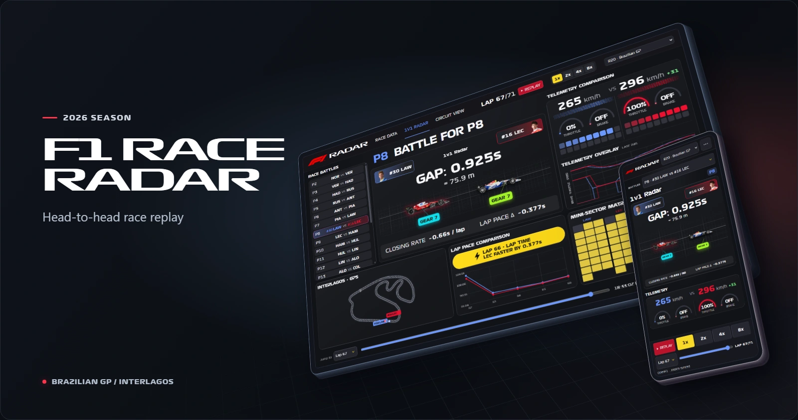

# F1 Race Radar



A mobile-first PWA for replaying head-to-head battles from completed 2026 Formula 1 races. Follow two drivers from lights out to the finish, with the gap, car positions, and telemetry synced to the same replay clock.

[Explore the MVP](#mvp-features) · [See the screenshots](#screenshots) · [Run locally](#run-locally)

## MVP features

- **1v1 Radar** — Pick a battle between adjacent drivers and follow the time gap and estimated distance with driver portraits and team liveries.
- **Race replay** — Browse completed 2026 Grands Prix, starting with the latest available race. Jump to any lap or the finish, scrub the timeline, and switch between **1×, 2×, 4×, and 8×**.
- **Synced telemetry** — Compare speed, throttle, braking, and gear. The radar interpolates car movement and readouts between recorded samples as playback speed changes.
- **Race analysis** — See GPS positions on the circuit, race classification, lap pace, gap history, and sector deltas.
- **Installable PWA** — Add the app to your home screen from a supported browser over HTTPS. It opens straight to 1v1 Radar and caches the app shell and bundled Brazilian GP snapshot for offline use.

## Screenshots

Liam Lawson and Charles Leclerc battle for P8 at Interlagos on lap 67 of the 2026 Brazilian GP.

<p align="center">
  <a href="docs/media/mobile-radar.png"></a>
  <a href="docs/media/mobile-lap-picker.png"></a>
</p>

<details>
<summary>Desktop dashboard with telemetry and circuit map</summary>


</details>

## Run locally

Requires Python 3.10 or newer. The build uses the Python standard library.

```sh
python build.py
python -m http.server 8000 --bind 127.0.0.1 --directory dist
```

Open [1v1 Radar](http://127.0.0.1:8000/#radar). Serve the checked-in `dist/` directory on an HTTPS static host to make the PWA installable on a phone. Use `python build.py --standalone` to also generate a single-file preview.

`src/` contains the app, assets, and bundled data. `build.py` generates `dist/`, including the web app manifest and service worker.

## Data and assets

[OpenF1](https://openf1.org/docs/) supplies archived timing, GPS, and car telemetry. [Jolpica F1](https://api.jolpi.ca/docs/) supplies results and standings. Other Grands Prix and telemetry outside the bundled windows load on demand, subject to upstream availability.

Team liveries and driver portraits come from the [Formula 1 teams](https://www.formula1.com/en/teams) and [2026 driver standings](https://www.formula1.com/en/results/2026/drivers) pages. The app uses the supplied F1 fonts and logo.
